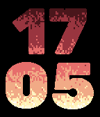
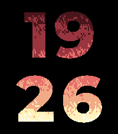
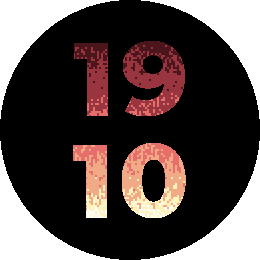
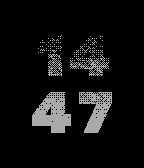
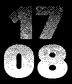
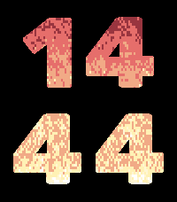
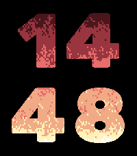
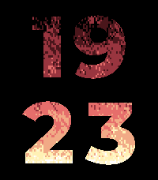

# Hearth

A Pebble watch face that shows the time as four large digits (HH over MM),
each one a window onto a live fire. Wherever a digit is you see flames;
everywhere else the screen is black.

Hearth is inspired by Yuri Galanter's
[Fireplace](https://github.com/ygalanter/fireplace), which plays recorded
flames through the time digits. Hearth draws its flames with the excellent
[PSX Doom fire](https://fabiensanglard.net/doom_fire_psx/) instead: a
ten-line rule that turns a bottom row of heat into rising, flickering flames.
It is ported faithfully and computed live on the watch.

The Doom fire is so simple and efficient that a frame of fire costs about a
millisecond or less, 10-39 times less work than decoding a recorded frame (see
[Compared with Fireplace](#compared-with-fireplace)). That leaves room for a
fire that responds to the world around it:

- **Weather:** the colder it is outside, the higher the flames burn.
- **Wind:** the flames lean with the local wind, or with a wind you set
  (color watches).
- **Time of day:** low flames by day, high at night, rising through dusk and
  dying down at dawn, from your local sunrise and sunset.
- **Accelerometer:** tap the watch or flick your wrist to stoke the fire, and
  on color watches tilt it to make the flames lean.

On B&W watches the fire is drawn with ordered dithering. Emery and Flint can
add a crackling sound, and Emery's RGB backlight can flicker with the flames.

| basalt | chalk | emery | gabbro |
|---|---|---|---|
|  |  |  |  |

| aplite | diorite | flint | Quick View (basalt) |
|---|---|---|---|
|  |  |  |  |

| Tap to stoke (emery, 0.3 s after a tap) | Flame height follows the sun: night | ...and day |
|---|---|---|
|  |  |  |

Screenshots come from the SDK emulator, which shows color the way the real
LCD does (for example, pure `AA0000` red looks muted). Aplite's screenshot
was captured over VNC, because `pebble screenshot` on the aplite emulator
returns the launcher, even for the SDK's template app.

## Platforms

All seven SDK 3 targets: aplite, basalt, chalk, diorite, emery, flint and
gabbro. Platform code is guarded with `PBL_BW`, `PBL_COLOR`,
`PBL_RGB_BACKLIGHT`, `PBL_SPEAKER`, `PBL_DISPLAY_WIDTH` and
`PBL_PLATFORM_APLITE` (which has no unobstructed-area service). A platform
without a feature does not compile its code.

## Settings

Open the settings from the Pebble app. Every change applies live. If a
notification is covering the face, the change applies when the face comes
back.

| Setting | Values | Default | Platforms |
|---|---|---|---|
| Frame rate | 5, 8, 10, 15, 20 fps | 10 | all |
| Animate | Always, On tap | Always | all |
| Resolution | Fine 1 px, Normal 2 px, Chunky 4 px | Normal | color |
| Flame height | 1-10 (tip heat 0-20, 5 = 9) | 5 | all |
| Flame height follows | the setting, outside temperature, the sun | the setting | all |
| Wind | -2 .. +2 (0 is Doom's own lean) | 0 | color |
| Wind follows the weather | on/off | off | color |
| Color theme | Classic, Ember, Blue, Green, Purple, Custom | Classic | color |
| Custom colors | 3 color pickers (embers, flames, hottest) | red, orange, yellow | color, Custom theme |
| Flare on the minute | on/off | off | all |
| Tap to stoke | on/off | on | all |
| Wind follows tilt | on/off | off | color |
| Flickering backlight | on/off | on | emery |
| Flicker amount | 0-100 % | 100 | emery |
| Crackling sound | on/off | on | emery, flint |
| Crackle volume | 1-10 | 3 | emery, flint |

The config page shows only the sections a watch supports. It also has a
palette preview and a "Reset to defaults" button.

### Battery

- **Animate: On tap** saves the most battery. The flames freeze 30 seconds
  after the last wrist tap or shake. While frozen, the frame timer, the
  backlight override, the crackle and the tilt sensor are all stopped, and
  only the minute tick wakes the watch.
- The face also pauses while a notification covers it.
- Lower frame rates and coarser resolutions cost less.

### Tap to stoke

Tap the watch or flick your wrist and the flames leap up, then settle back over
a few seconds. It uses the accelerometer's tap events, which cost nothing
between taps. With Animate: On tap, the same tap also wakes the face.

### Sky: sun and weather

**Flame height follows** can take the flame height from outside:

- **The sun.** Low flames by day (height 3) and high at night (height 8). The
  height ramps linearly over an hour centered on sunrise and on sunset, so
  the fire builds up through dusk and dies down through dawn. The phone
  computes sunrise and sunset from your location with the sunrise equation
  that NOAA's calculator uses (accurate to a few minutes, no network). Polar
  night, midnight sun, and a sunset after midnight (far north in summer) are
  handled. The watch recomputes the height every minute, so it follows the
  sun even when the phone is away.
- **Outside temperature.** The colder it is, the higher the fire: height 10 at
  -10 °C or below, 3 at 30 °C or above, linear in between. It never drops
  below 3, because lower heights fade the hours to embers and make the time
  hard to read.

**Wind follows the weather** (color watches) leans the flames with the local
wind. The watch has no compass, so wind is drawn as on a map: the east-west
part of the wind, with wind toward the east blowing right. An east-west part
under 6 km/h counts as calm (0), 6-20 km/h as a breeze (±1), and anything
stronger as strong (±2).

Weather comes from [Open-Meteo](https://open-meteo.com/): free, no API key,
data licensed CC BY 4.0. The watch asks the phone for what its settings need:
sun times, weather or both. It asks a few seconds after starting, after a
settings change, and every 30 minutes, and only while one of these settings is
on. The watch decides, not the phone's copy of the settings, so this keeps
working on a new phone. Sun and weather updates never wake a face that has
frozen (Animate: On tap). The phone looks up the location for each request,
and rounds it to two decimals (about 1 km) before sending it to Open-Meteo.
Sun times never leave the phone. The phone maps everything to the face's units
(`src/pkjs/sky.js`), so the mapping can change without a watch update. The
watch keeps the last values across restarts, and falls back to the Flame
height and Wind settings until the first values arrive. The app declares the
`location` capability.

### Why there is no "blow on the fire" (microphone)

The SDK refuses microphone access to watchfaces: `mic_capture_start` returns
`MicCaptureStartErrWatchface`, and the header says "Watchfaces can never
stream". A breath-controlled fire would have to be a separate watchapp (with a
Microphone grant), not this face. Tap to stoke and Wind follows tilt are the
accelerometer alternatives.

### Flickering backlight (emery)

While the flames are animating and this setting is on, Hearth **keeps the
backlight on** and tints it from the flames. That overrides the backlight
timeout and the ambient light sensor, and **drains the battery quickly**.
Hearth gives the light back to the system whenever the setting is off, the
face is frozen (Animate: On tap), or a notification covers the face. The
setting is on by default (as specified); turn it off for normal battery life.

### Crackling sound (emery, flint)

Hearth plays short pops of decaying noise with random pitch and loudness, in
clusters. It stays silent when the speaker is muted, during Quiet Time, and
while anything else is playing.

## How it works

- `src/c/fire.c` is the fire engine: Doom's `spreadFire`, ported faithfully
  from [Fabien Sanglard's DoomFirePSX](https://github.com/fabiensanglard/DoomFirePSX)
  (quoted in the source). It uses the same column-by-column loop, the same
  rule (a zero pixel blanks the one above; otherwise
  `dst = src - randIdx + 1` and `pixel - (randIdx & 1)`), and the same
  non-uniform offset distribution as `Math.round(Math.random() * 3)` (0 and 3
  half as likely as 1 and 2). The only differences are xorshift32 instead of
  `Math.random`, and edge wrap within the row instead of into the next row.
  It is plain C with no Pebble dependency, so it can be tested on the host.

  The watch face adapts only what is around the algorithm:
  - **Flame height = number of rows.** Doom decays about half a level per
    row, so the engine runs as many rows as the requested tip heat needs
    (63 for the default tip heat 9). The renderer stretches those rows over
    the digit window, whatever its height. The decay per row depends on the
    `+ 1`, because Doom's column order lets heat written to the right spread
    again in the same frame, so rows come from a table measured per wind on
    the host. Changing the flame height (from the setting, the sun or the
    temperature) only changes the row count. The algorithm is untouched.
  - **Wind = Doom's `+ 1`.** Wind 0 is Doom exactly, which leans left half a
    cell per row. Wind 1 leans as much to the right, and wind ±2 leans further.
  - **Stoke and the minute flare** add heat to every cell at once, which
    Doom's fire then burns down. This is an event from outside, like Doom's
    own "fire on/off".
- `src/c/layout.c` centers each row by its real width, and centers the block
  in the unobstructed bounds (shrinking the row gap first when space is
  short). It derives the flame window from the worst-case metrics in
  `src/c/generated/metrics.h`.
- `src/c/flames.c` draws the digits white, then rewrites only the white
  pixels inside the flame window. Color platforms take one palette lookup per
  digit pixel, using `gbitmap_get_data_row_info` so round screens get the
  right x range. B&W platforms AND each framebuffer byte with two 4x4 dither
  patterns, one per 4 px cell.
- `src/c/settings.c` keeps one `Settings` struct, persisted under one key
  with a leading version byte. The phone sends one int32 AppMessage key per
  setting.
- `src/c/backlight.c` (emery) handles the backlight and `src/c/crackle.c`
  (emery, flint) handles the sound.

### Departures from the spec

The spec's engine (cooling as a chance in 64ths, a 4-entry shift table,
turbulence) is replaced by the faithful Doom algorithm above, at the owner's
request. With that change:

| What | Spec | Now | Why |
|---|---|---|---|
| Flame height | cooling chance per row | number of Doom rows, stretched over the window | Keeps Doom's rule untouched. |
| Turbulence setting | Calm, Normal, Wild | removed | Doom has one fixed offset distribution. |
| Wind | added to a shift table | Doom's `+ 1` constant | Same reason. Wind 0 is Doom's own lean. |
| Flare on the minute | +fuel for about 1 s | +8 heat to every cell at once | Doom's fuel row is already at full heat. |
| Grid edges | padding cells, written but never read | wrap within the row | As close to Doom's own wrap as a 2-D grid allows. |
| B&W dither ramp | not specified | no dots at heat 6 or below, solid at 30 or above, linear between | A linear 0-36 ramp reads as a halftone gradient. This one gives a solid base with broken, flickering tips. |
| Backlight center | 227 fixed | running average, starting at 227 | Keeps the flicker centered when the flame height moves the mean heat. |

Everything else uses the spec's values: digit font sizes 59/59/110/104, gaps
8/8/16/15 and 14/14/28/26, tip heat 9, 10 fps and 2 px cells.

## Measurements (emulator, SDK 4.44)

Free heap after startup with the default settings (2 px on color), and with
each resolution where it applies:

| Platform | Default | Fine 1 px | Normal 2 px | Chunky 4 px |
|---|---|---|---|---|
| aplite | 12,500 | - | - | (B&W, 4 px) |
| diorite | 54,052 | - | - | (B&W, 4 px) |
| flint | 53,132 | - | - | (B&W, 4 px) |
| basalt | 51,316 | 47,144 | 51,316 | 53,352 |
| chalk | 51,488 | not measured | 51,488 | not measured |
| emery | 109,996 | 102,140 | 109,996 | 113,876 |
| gabbro | 112,392 | 105,020 | 112,392 | 116,080 |

The engine always allocates its maximum number of rows (97), so changing the
flame height never allocates memory. Fine fits comfortably everywhere, so no
platform hides it. Switching resolutions back and forth returned to exactly
the same free heap at each size, so there is no leak.

Average time per frame over the first 100 frames, default settings, as
logged by the face:

| Platform | Fire step | Draw |
|---|---|---|
| aplite | 0.02 ms | 0.32 ms |
| diorite | 0.03 ms | 0.28 ms |
| flint | 0.02 ms | 0.21 ms |
| basalt | 0.12 ms | 0.36 ms |
| chalk | 0.15 ms | 0.32 ms |
| emery | 0.26 ms | 1.05 ms |
| gabbro | 0.02 ms | 0.61 ms |

QEMU does not model the real CPU's speed and `time_ms` is coarse, so treat
these figures as relative only. They should be measured again on hardware.
The face logs this line once per launch (`per frame: step ..., draw ...`).

## Compared with Fireplace

[Fireplace](https://github.com/ygalanter/fireplace) plays recorded flames.
On color watches it decodes the next frame of an animated PNG each frame
(`gbitmap_sequence_update_bitmap_next_frame`, about 36 KB of 8-bit pixels on
emery). On B&W watches it copies the next 1.3 KB frame out of flash. Hearth
computes its flames each frame instead. Both then recolor the digits the same
way (one compare per pixel in the flame window), so the per-frame difference
is that first step. Both run at 10 fps by default.

**Per-frame work**, with each face's step run 200 times back to back. I used
Fireplace from source, timed the same way (`tools/bench/bench.h`), on the SDK
4.44 emulators. The emulators were run with an instruction-counting clock
(`tools/bench/qemu-pebble`, QEMU `-icount`), so the times count CPU work
rather than this machine's speed:

| Platform | Fireplace (decode/copy a frame) | Hearth (Doom step, Normal 2 px) | Hearth is |
|---|---|---|---|
| aplite | 2.06-2.24 ms | 0.055 ms | ~39× less |
| diorite (also flint) | 0.80-0.86 ms | 0.080 ms | ~10× less |
| basalt (also chalk) | 4.02-4.24 ms | 0.095-0.120 ms | ~38× less |
| emery | 30.9-31.3 ms | 1.15 ms | ~27× less |
| gabbro | 28.4 ms | 1.10 ms | ~26× less |

Compare these numbers within a row, not across platforms: emery's and
gabbro's emulator boards count time differently from the older ones. Hearth
with Fine (1 px) has twice the columns and so should do about twice
Normal's step work (not measured); that is still an order of magnitude below
Fireplace's frame decode.

**Memory and storage**, from the same builds:

| | Fireplace | Hearth |
|---|---|---|
| Free heap, basalt | 33,060 B | 51,316 B |
| Free heap, emery | 49,376 B | 109,996 B |
| Resources, basalt | 98 KB (recorded flames) | 7.6 KB (digits only) |
| Resources, emery | 181 KB | 12 KB |

Caveats:
- These are instruction counts, not hardware cycles. On a real watch, both
  faces' resource reads come from external flash with wait states. That costs
  Fireplace every frame and Hearth only when a digit changes, so hardware
  would likely widen the gap rather than close it. Measure on hardware to be
  sure.
- The step is not the whole frame. Recoloring the digits costs both faces
  about the same (0.3-1 ms per frame on the plain emulator clock).
- Fireplace's emery/gabbro build also tints the backlight from each decoded
  frame. Hearth's backlight was off for these runs, and Fireplace's flicker
  code was outside the timed step.

## Building

```sh
pip install pebble-tool          # then: pebble sdk install latest
npm install                      # @rebble/clay
python3 tools/build_assets.py    # only when changing digit art or metrics
pebble build
pebble install --emulator emery
```

`tools/build_assets.py` (needs Pillow) generates the digit bitmaps
(`resources/digits/<d>~<tag>.png`, tags `144w`, `180w`, `200w` and `260w`),
`src/c/generated/metrics.h` and the menu icon. The generated files are
committed, so a plain `pebble build` works without Python.

### Publishing to the Pebble app store

Everything the store needs is in `store/`:

| File | What |
|---|---|
| `icon-80.png`, `icon-144.png` | store icons: the face in miniature, generated by `tools/build_store_assets.py` |
| `screenshots/` | one rollover GIF and one still per platform, from the SDK emulators |
| `description.txt`, `release-notes.txt` | listing text |
| `publish.sh` | runs `pebble publish` with all of the above |

To publish, on your own machine, from a clone of this repository:

```sh
pebble login        # browser sign-in to the store, once
store/publish.sh    # builds, asks for confirmation, uploads
```

Before you publish, check these:

- **It goes live at once.** pebble-tool 5.1.2 sends every upload as published
  and visible: its `--is-published` flag is ignored. Test on a real watch
  first (`pebble install --phone <phone IP>` with the Pebble app's developer
  connection on): the settings page, live weather, and on emery the
  backlight and crackle.
- **Source link.** The listing links to
  https://github.com/graus/hearth-pebble-watchface; set `HEARTH_SOURCE_URL`
  to use another.
- **Category.** The script uses the store's default watchface category. You
  can change it, the description and the screenshots later on the developer
  dashboard.

To refresh the screenshots, record new rollover GIFs with
`pebble screenshot --gif-all-platforms` (it needs ffmpeg; headless, run it
under `xvfb-run`) and copy them into `store/screenshots/`.

### Host tests

```sh
make -C tools/host
```

These tests build the engine with `-fsanitize=address,undefined`. They step
the fire at every platform's width and resolution, every wind from -2 to 3,
and tip heats from 0 to 20. They check that no write goes out of bounds, that
heat stays within 0-36, and that the mean heat of the top row is within 2 of
the requested tip heat. They also check that stoke raises the fire, that live
changes of height, wind and stoke stay safe, and that degenerate widths do not
crash.

`make` also runs `test_daylight`, which checks the sunrise and sunset ramp:
an ordinary day, a sunset after midnight, a sunrise before it, polar night and
midnight sun.

```sh
TZ=Europe/Amsterdam node tools/host/test_sky.js
```

This tests the phone side: the weather mapping against a response in
Open-Meteo's format, and sun times against published tables (Amsterdam at
both solstices, Reykjavik's midsummer sunset after midnight, Tromsø's polar
night and midnight sun).

## Credits

- **[Fireplace](https://github.com/ygalanter/fireplace)** by Yuri Galanter
  (MIT) is the original Pebble watch face with flames seen through the time
  digits. Hearth is a from-scratch reimplementation of that idea. It simulates
  the fire instead of playing recorded frames, and shares no code or assets
  with Fireplace.
- **The PSX Doom fire**, from id Software's PlayStation Doom, as
  reverse-engineered and published by Fabien Sanglard
  ([write-up](https://fabiensanglard.net/doom_fire_psx/),
  [DoomFirePSX](https://github.com/fabiensanglard/DoomFirePSX)). Hearth's
  engine is an independent C transcription of its ten-line `spreadFire` rule.
  DoomFirePSX has no license file. The rule is quoted in `src/c/fire.c` for
  reference.
- **[doom-fire-algorithm](https://github.com/filipedeschamps/doom-fire-algorithm)**
  by Filipe Deschamps (MIT), an open-source collection of Doom fire
  implementations, used as a reference for efficient ports: one in-place
  array, one random number per pixel, and a palette index per heat level.
- Weather data by [Open-Meteo.com](https://open-meteo.com/) (CC BY 4.0).

## License notes

Hearth's code is under the [MIT License](LICENSE).

The digits are rendered from **Montserrat ExtraBold** (Copyright 2024 The
Montserrat.Git Project Authors), licensed under the
[SIL Open Font License 1.1](tools/fonts/OFL.txt). The font file is in
`tools/fonts/` and is used only at build time to make the bitmaps.
