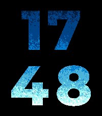
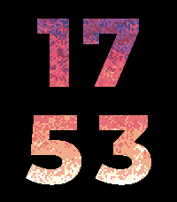

# Hearth

A Pebble watch face that shows the time as four large digits (HH over MM), each
one a window onto a live fire. Wherever a digit is you see flames; everywhere
else the screen is black. The fire is simulated with the
[Doom fire algorithm](https://fabiensanglard.net/doom_fire_psx/) on every
platform. On B&W watches it is drawn with ordered dithering. Emery and Flint
can add a crackling sound, and Emery's RGB backlight can flicker with the
flames.

| basalt | chalk | emery | gabbro |
|---|---|---|---|
|  |  |  |  |

| aplite | diorite | flint | Quick View (basalt) |
|---|---|---|---|
|  |  |  |  |

| Blue theme, fine (emery) | Custom colors, wild turbulence, tilt wind (emery) |
|---|---|
|  |  |

Screenshots come from the SDK emulator, which shows color the way the real
LCD does (for example, pure `AA0000` red looks muted). Aplite's screenshot
was captured over VNC, because `pebble screenshot` on the aplite emulator
returns the launcher, even for the SDK's template app.

## Platforms

All seven SDK 3 targets: aplite, basalt, chalk, diorite, emery, flint and
gabbro. Platform code is guarded with `PBL_BW`, `PBL_COLOR`,
`PBL_RGB_BACKLIGHT`, `PBL_SPEAKER`, `PBL_DISPLAY_WIDTH` and
`PBL_PLATFORM_APLITE` (which has no unobstructed-area service). A platform
without a feature does not compile its code.

## Settings

Open the settings from the Pebble app. Every change applies live. If a
notification is covering the face, the change applies when the face comes
back.

| Setting | Values | Default | Platforms |
|---|---|---|---|
| Frame rate | 5, 8, 10, 15, 20 fps | 10 | all |
| Animate | Always, On tap | Always | all |
| Resolution | Fine 1 px, Normal 2 px, Chunky 4 px | Normal | color |
| Flame height | 1-10 (top heat 0-20, 5 = 9) | 5 | all |
| Wind | -2 .. +2 | 0 | color |
| Turbulence | Calm, Normal, Wild | Normal | color |
| Color theme | Classic, Ember, Blue, Green, Purple, Custom | Classic | color |
| Custom colors | 3 color pickers (embers, flames, hottest) | red, orange, yellow | color, Custom theme |
| Flare on the minute | on/off | off | all |
| Wind follows tilt | on/off | off | color |
| Flickering backlight | on/off | on | emery |
| Flicker amount | 0-100 % | 100 | emery |
| Crackling sound | on/off | on | emery, flint |
| Crackle volume | 1-10 | 3 | emery, flint |

The config page shows only the sections a watch supports. It also has a
palette preview and a "Reset to defaults" button.

### Battery

- **Animate: On tap** saves the most battery. The flames freeze 30 seconds
  after the last wrist tap or shake. While frozen, the frame timer, the
  backlight override, the crackle and the tilt sensor are all stopped, and
  only the minute tick wakes the watch.
- The face also pauses while a notification covers it.
- Lower frame rates and coarser resolutions cost less.

### Flickering backlight (emery)

While the flames are animating and this setting is on, Hearth **keeps the
backlight on** and tints it from the flames. That overrides the backlight
timeout and the ambient light sensor, and **drains the battery quickly**.
Hearth gives the light back to the system whenever the setting is off, the
face is frozen (Animate: On tap), or a notification covers the face. The
setting is on by default (as specified); turn it off for normal battery life.

### Crackling sound (emery, flint)

Hearth plays short pops of decaying noise with random pitch and loudness, in
clusters. It stays silent when the speaker is muted, during Quiet Time, and
while anything else is playing.

## How it works

- `src/c/fire.c` is the fire engine. It is plain C with no Pebble dependency,
  so it can be tested on the host. It uses one `uint8_t` heat grid (0-36),
  with the hidden fuel row below the visible rows. Each step makes one
  xorshift32 per cell: bits 16-17 pick the sideways shift and bits 20-29 the
  cooling. Rows padded by the largest possible shift (4) keep shifted writes
  inside their row.
- `src/c/layout.c` centers each row by its real width, and centers the block
  in the unobstructed bounds (shrinking the row gap first when space is
  short). It derives the flame window from the worst-case metrics in
  `src/c/generated/metrics.h`.
- `src/c/flames.c` draws the digits white, then rewrites only the white
  pixels inside the flame window. Color platforms take one palette lookup per
  digit pixel, using `gbitmap_get_data_row_info` so round screens get the
  right x range. B&W platforms AND each framebuffer byte with two 4x4 dither
  patterns, one per 4 px cell.
- `src/c/settings.c` keeps one `Settings` struct, persisted under one key
  with a leading version byte. The phone sends one int32 AppMessage key per
  setting.
- `src/c/backlight.c` (emery) handles the backlight and `src/c/crackle.c`
  (emery, flint) handles the sound.

### Tuned values (changed from the spec's host-simulation starting points)

| What | Spec start | Final | Why |
|---|---|---|---|
| Cooling resolution | 64ths | 1024ths, rounded | On a 178-row grid, 64ths truncate 12.9 to 12 and the top overshoots by 2-3 levels. |
| Cooling on short grids | whole + fraction | a quantum of `ceil(mean)` with chance `mean / quantum` | B&W's 25-row grid needs about 1.08 levels per step. Losing 1 every step gives a smooth gradient with no flames in it. |
| Reach near 0 | `36 - top_heat` | aims up to 2 levels lower when `top_heat < 2` | The clamp at 0 lifts the mean of a nearly dead top row. |
| B&W dither ramp | not specified | no dots at heat 6 or below, solid at 30 or above, linear between | A linear 0-36 ramp reads as a halftone gradient. This one gives a solid base with broken, flickering tips. |
| Backlight center | 227 fixed | running average, starting at 227 | Keeps the flicker centered when reach or resolution moves the mean heat. |

Everything else uses the spec's values: digit font sizes 59/59/110/104, gaps
8/8/16/15 and 14/14/28/26, top heat 9, shift table `{-1, 0, 0, 1}`, 10 fps
and 2 px cells.

## Measurements (emulator, SDK 4.44)

Free heap after startup with the default settings (2 px on color), and with
each resolution where it applies:

| Platform | Default | Fine 1 px | Normal 2 px | Chunky 4 px |
|---|---|---|---|---|
| aplite | 15,064 | - | - | (B&W, 4 px) |
| diorite | 56,612 | - | - | (B&W, 4 px) |
| flint | 55,652 | - | - | (B&W, 4 px) |
| basalt | 54,120 | 47,180 | 54,072 | 55,896 |
| chalk | 54,120 | 47,180 | 54,072 | 55,896 |
| emery | 110,708 | 86,440 | 110,368 | 116,508 |
| gabbro | 113,268 | 92,060 | 113,228 | 118,716 |

Fine fits comfortably everywhere, so no platform hides it. Ten resolution
switches on emery returned to exactly the same free heap at each size, so
there is no leak.

Average time per frame over the first 100 frames, default settings, as
logged by the face:

| Platform | Fire step | Draw |
|---|---|---|
| aplite | 0.01-0.02 ms | 0.40 ms |
| diorite | 0.08-0.12 ms | 0.36-0.50 ms |
| flint | < 0.01 ms | 0.22-0.45 ms |
| basalt | 0.07 ms | 0.44 ms |
| chalk | 0.04 ms | 0.48 ms |
| emery | 0.04-0.62 ms | 0.85-1.04 ms |
| gabbro | 0.01 ms | 0.92 ms |

QEMU does not model the real CPU's speed and `time_ms` is coarse, so treat
these figures as relative only. They should be measured again on hardware.
The face logs this line once per launch (`per frame: step ..., draw ...`).

## Building

```sh
pip install pebble-tool          # then: pebble sdk install latest
npm install                      # @rebble/clay
python3 tools/build_assets.py    # only when changing digit art or metrics
pebble build
pebble install --emulator emery
```

`tools/build_assets.py` (needs Pillow) generates the digit bitmaps
(`resources/digits/<d>~<tag>.png`, tags `144w`, `180w`, `200w` and `260w`),
`src/c/generated/metrics.h` and the menu icon. The generated files are
committed, so a plain `pebble build` works without Python.

### Host tests

```sh
make -C tools/host
```

These tests build the engine with `-fsanitize=address,undefined`. They step
the fire at every platform's grid size, for every turbulence and wind setting
and every reach from 0 to 20. They check that no write goes out of bounds,
that heat stays within 0-36, and that the mean heat of the top row is within
2 of the reach (without wind). They also check that a flare raises the top
and that degenerate grids do not crash.

## License notes

The digits are rendered from **Montserrat ExtraBold** (Copyright 2024 The
Montserrat.Git Project Authors), licensed under the
[SIL Open Font License 1.1](tools/fonts/OFL.txt). The font file is in
`tools/fonts/` and is used only at build time to make the bitmaps.
